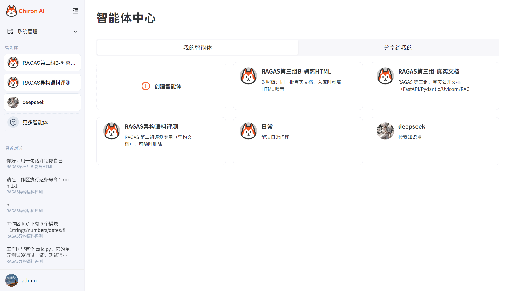
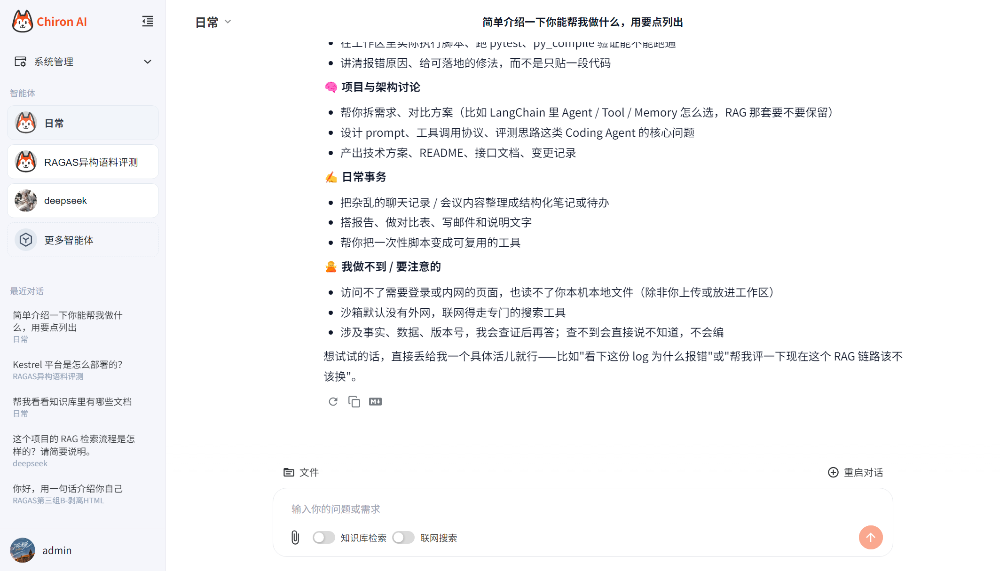
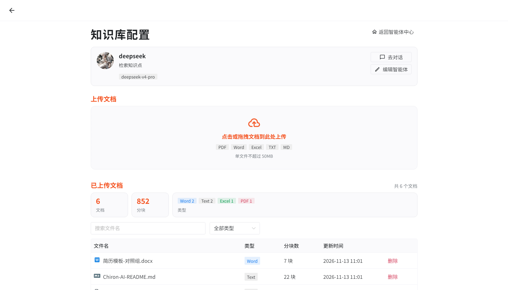

<p align="center">
  
</p>

<h1 align="center">Chiron AI</h1>

<p align="center">
  基于 FastAPI + Vue 3 + LangChain + LangGraph 的智能体平台：可自建智能体、挂载多模态知识库、接入 MCP 外部工具，<br/>
  并由一层受控工作区支撑「读写文件 / 执行命令」这类真正会改变环境的操作。
</p>

<p align="center">
  
  
  
  
  
  
</p>

---

## 核心功能

### 智能体中心

每个智能体独立配置模型、提示词、知识库、MCP 工具与记忆策略；支持分享给他人复用，也可从别人分享的智能体一键派生。



### 多轮对话

Agent 走 Tool-Use-Loop 自主规划：按需调用知识库检索、联网搜索、会话记忆、附件读写、工作区操作。思考过程可折叠查看，底部可实时切换「知识库检索 / 联网搜索」开关。



超出上下文预算时会自动压缩成摘要，原文不丢（append-only），AI 回复上方的「记忆已注入」标记即表示长期记忆参与本轮生成。

### 多模态知识库

支持 PDF / Word / Excel / TXT / Markdown，单文件上限 50 MB。文档按 L1/L2 父块 + 叶子块两级切分，图片单独抽取并建立向量索引，检索时文本与图片统一排序。



---

## 技术架构

```
┌──────────────────────────────────────────────────────────┐
│  Vue 3 + Vite + Pinia        对话 / 智能体 / 知识库 / 管理  │
└───────────────────────────┬──────────────────────────────┘
                            │ SSE（可断线重连）
┌───────────────────────────▼──────────────────────────────┐
│  FastAPI                                                  │
│  ├── app/chat     Agent 主链路 · 审批 · 记忆 · 压缩         │
│  ├── app/kb       RAG 子图 · 多模态入库 · 检索             │
│  ├── app/workspace 受控工作区（Docker / 本地双后端）        │
│  └── app/mcp_client MCP 服务接入与工具策略                 │
└───────┬──────────────┬──────────────┬────────────────────┘
        │              │              │
   PostgreSQL       Redis          Milvus + MinIO
   会话/元数据    缓存/配额/锁     向量库 / 对象存储
```

| 层次 | 关键实现 |
|---|---|
| Agent 编排 | LangChain + LangGraph，支持中断-恢复（checkpointer 持久化） |
| RAG | LangGraph 子图：检索 → 打分 → 条件扩展（HyDE / step-back） |
| 记忆 | 短期滑动窗口 + 长期向量记忆（Milvus dense + BM25 sparse） |
| 工作区 | Docker 沙箱 / 本地目录双后端，Docker 不可用时自动降级 |
| 实时性 | 对话走异步 Job + SSE，刷新页面可续传，不会丢回复 |

---

## 几个设计决策

### 1. 工作区不是「给个 shell」，是「给个受控环境」

`open_workspace()` 按 `{uid}/{aid}/{sid}` 三段分目录做租户隔离，后端可在 Docker 沙箱与本地目录之间切换：

- **Docker 不可用时自动降级 local 并记 warning** —— 不能因为沙箱挂了就让整个对话失败
- **`execute` 已实现但不作为工具暴露** —— 审批中断落地之前，模型不该具备执行任意 shell 的能力

### 2. 审批中间件：包住 LangChain 的重排层

LangChain 的 `HumanInTheLoopMiddleware` 只按**工具名**判定是否中断，`interrupt_on` 没有「按参数再判断」的钩子。结果是一旦登记 `workspace_run_command`，连 `ls -la` 都要用户点一次确认。

做法是在 `after_model` 里加一层前置判断：这条 AI 消息里的命令调用**是否可证明全部只读**——

- 全部只读 → 从 `interrupt_on` 里摘掉该工具，交给官方中间件
- 有任何一条不安全 → 原样交给官方中间件，**全部命令一起中断**

只改「要不要中断」这一件事，其余全部沿用官方实现。

### 3. 上下文隔离靠 ContextVar，不靠传参

RAG 检索步骤、工具配额这些状态被 `app/chat`、`app/kb`、`app/core` 三方共用。放在 `app/chat` 下会让知识库反向依赖对话域，所以下沉到 `app/core/turn_runtime.py`。

状态挂在**按请求创建**的 `_RequestState` 上，经 `ContextVar` 分发。`asyncio.create_task` / `to_thread` / `run_in_executor` 都会复制当前 contextvars 上下文（同一对象引用），同步路径整体跑在单线程内——因此并发请求互不可见，杜绝跨用户的 RAG 步骤串扰。

### 4. 会话压缩：摘要进 metadata，原文永不删

上下文按字符预算触发压缩，摘要写进 session metadata，原文窗口保持 append-only。最多保留 4 个压缩态，避免反复压缩把信息磨平。这样既能控制 token，又保留可回溯的原始对话。

### 5. 知识库分层：父块给模型，叶子块给检索

检索命中的是叶子块（600 字左右），但送给模型的是它的父块——命中精度靠小块，上下文完整性靠大块。图片单独建索引，检索时与文本块统一打分排序，避免「图文混排的文档只能答一半」。

---

## 快速开始

### 环境要求

Python 3.11+ · Node 18+ · pnpm · Docker Desktop

### 1. 启动依赖服务

```bash
docker compose up -d      # PostgreSQL / Redis / etcd / MinIO / Milvus
```

### 2. 配置环境变量

```bash
cp .env.example .env
```

至少填写：`SECRET_KEY`（`openssl rand -hex 32`）、`INITIAL_ADMIN_PASSWORD`、`EMBEDDING_API_KEY`。

启用重排需再填 `RERANK_API_KEY`；国内联网搜索可填 `WEB_SEARCH_BOCHA_API_KEY`。完整项见 `.env.example` 注释。

### 3. 启动后端

```bash
python -m venv venv
source venv/bin/activate        # Windows: .\venv\Scripts\activate
pip install -r requirements.txt -i https://pypi.tuna.tsinghua.edu.cn/simple
python run.py
```

默认监听 `127.0.0.1:19999`（`.env` 的 `UVICORN_PORT` 可改），API 文档见 `http://localhost:19999/docs`。

### 4. 启动前端

```bash
cd web
pnpm i
pnpm dev
```

打开 `http://localhost:3200`，用 `.env` 里的 `INITIAL_ADMIN_USERNAME` / `INITIAL_ADMIN_PASSWORD` 登录。

> 想验一遍全链路是否正常：`python scripts/verify_chat_e2e.py`（登录 → 发起对话 → 轮询 → 判定）。

---

## 项目结构

```
app/
├── api/            FastAPI 路由（v1）
├── chat/           Agent 主链路：审批 / 记忆 / 压缩 / 附件 / 工具网关
├── kb/             RAG 子图 / 多模态入库 / 父块存储 / 图片索引
├── workspace/      受控工作区（Docker 沙箱 + 本地目录）
├── mcp_client/     MCP 服务接入、工具策略与预设
├── core/           运行时状态 / DB / 缓存 / 对象存储 / 异常
├── models/         Tortoise ORM 模型
└── settings/       配置（pydantic-settings）
web/
├── src/views/      agent-hub / agent-chat / agents / system / profile
└── src/utils/      请求封装 / 认证 / 存储
scripts/            运维与回归脚本（端到端对话、重建索引、重置密码）
deploy/             Dockerfile、nginx 配置、示例截图
```

代码规模：后端约 170 个 Python 文件 / 3 万行，前端约 110 个组件。

---

## 生产部署

`docker-compose.prod.yml` 会把前端打包成静态文件交给 Nginx、后端单独一个容器，Nginx 反代 `/api/v1`：

```bash
docker compose -f docker-compose.prod.yml up -d --build
```

访问 `http://localhost:8088`（端口由 `.env` 的 `WEB_PORT` 控制）。

上线前务必核对：

- `DEBUG=false`（否则 Header `token=dev` 可绕过 JWT）
- `ALLOW_PUBLIC_REGISTRATION=false`、`DOCS_ENABLED=false`
- 生产环境单独配置 `API_KEY_ENCRYPTION_KEY`，不要只靠 `SECRET_KEY` 派生
- 数据库与对象存储端口保持在 `127.0.0.1`，不要映射到公网
- 前置 Nginx/Caddy 做 HTTPS 反代

---

## 致谢

项目脚手架基于 [vue-fastapi-admin](https://github.com/mizhexiaoxiao/vue-fastapi-admin)。

## License

MIT
